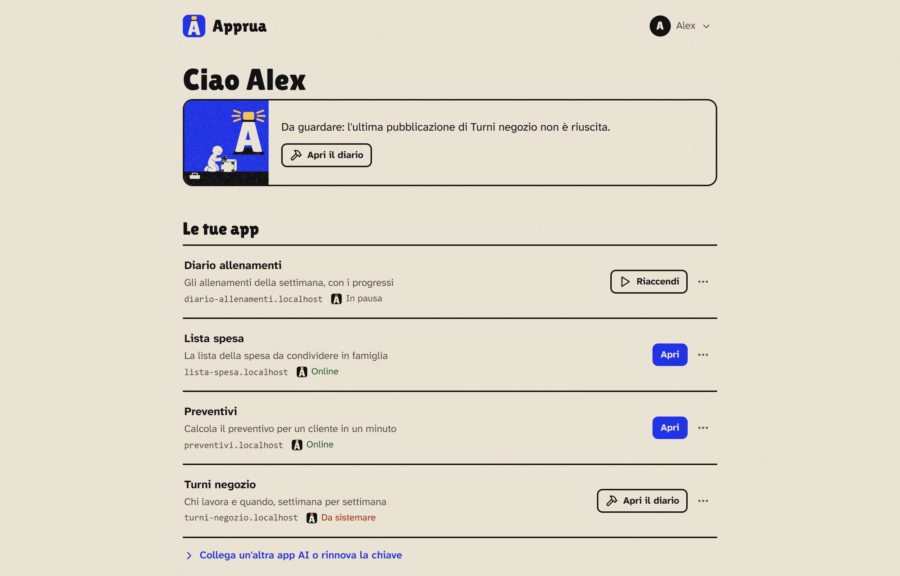

<p align="center"></p>

<h1 align="center"></h1>

<p align="center"><b>Hai fatto un'app con l'AI. Ora usala davvero.</b><br>
Apprua la mette sul tuo PC o sul tuo server, con una frase alla tua app AI.</p>

<p align="center"><a href="docs/guida/pc.md"><b>Installa su Windows</b></a> &nbsp;·&nbsp; <a href="docs/guida/server.md"><b>Installa su un server</b></a> &nbsp;·&nbsp; <a href="README.md">English</a></p>

---

Una lista della spesa, un calcolatore di preventivi, uno strumento per il tuo gruppo: l'ha scritto l'AI e funziona, ma vive in una chat o in una cartella. Apprua dà alla tua app un indirizzo vero, che aprite tu e le persone che scegli. Niente Git, Docker, server o certificati da imparare. Gratis e open source.

## Tre passi, poi basta chiedere

**1. Installa Apprua** sul tuo PC Windows o su un server Linux. Copi un comando, al resto pensa l'installer (la prima volta ci vuole un po': scarica quello che serve).

**2. Collega la tua app AI.** Il portale ti dà le righe da incollare, con la tua chiave personale già dentro. Funziona con Claude, OpenAI Codex, Cursor, VS Code e ogni app che supporta i connettori MCP.

**3. Scrivi alla tua AI:**

> "Pubblica questa app su Apprua."

Dopo qualche minuto la tua AI risponde con l'indirizzo dell'app. Per cambiarla chiedi la modifica e poi "aggiornala su Apprua". Metterla in pausa, darle un segreto, tornare alla versione di ieri: lo chiedi in chat, allo stesso modo.

<p align="center"></p>

## Perché piace

- **Resta a casa tua.** Apprua gira sulla tua macchina e non ha un cloud suo: le app e i loro dati restano sul tuo PC o sul tuo server, e decidi tu chi può aprire ciascuna.
- **Niente di nuovo da imparare.** Continui a parlare con la tua app AI come fai già. Apprua impacchetta, controlla, costruisce e pubblica.
- **Protezioni fin dall'inizio.** Davanti a ogni app in rete c'è l'accesso con account; ogni app gira nel suo spazio, con la sua memoria; una pubblicazione con i tipi più comuni di password e chiavi nei file viene rifiutata prima di essere pubblicata.
- **Ogni versione resta.** Ogni pubblicazione viene conservata: per tornare indietro basta una frase, e il codice si può sempre scaricare.
- **Per te o per il tuo gruppo.** Un profilo personale senza niente da impostare, o un profilo per il gruppo con account, limiti e amministratori.
- **Un portale tranquillo.** In italiano e in inglese, chiaro e scuro, anche sul telefono.

## A cosa serve

| Ci sta bene | Non va bene per |
|---|---|
| Strumenti per te o per l'ufficio: liste, calcoli, moduli, cruscotti | Siti e servizi con migliaia di visitatori |
| Piccoli gestionali e archivi | Modelli di AI che girano in locale |
| Prototipi da far provare ad altre persone | Video da elaborare e database molto grandi |
| App usate da qualche decina di persone | Sul PC: app che devono funzionare anche a PC spento |

Ogni app ha la sua memoria (di solito da 512 MB a 2 GB) e un amministratore può dargliene di più, fino a quanto la macchina permette.

## Da dove partire

| Chi sei | Dove si installa | Guida |
|---|---|---|
| Una persona che vuole tenere le sue app | Il tuo PC Windows | [Apprua sul tuo PC](docs/guida/pc.md) |
| Un team, uno studio, un'azienda | Un server Linux | [Apprua su un server](docs/guida/server.md) |

Poi [collega la tua app AI](docs/guida/collegare.md), [l'uso di ogni giorno](docs/guida/ogni-giorno.md) e, se qualcosa non va, i [problemi comuni](docs/guida/problemi.md). La guida completa parte [da qui](docs/guida/README.md).

## Come funziona

```
app AI ──MCP──▶ connettore Apprua (sul tuo PC) ──chiave──▶ Apprua (il tuo PC o server) ──▶ motore (Coolify) ──▶ la tua app
                                                                 │
                                                                 └─ archivio del codice (ogni versione di ogni app)
```

Apprua controlla quello che arriva, conserva la versione e chiede al motore di costruire e far girare l'app. Il primo motore è [Coolify](https://coolify.io); sta dietro una piccola interfaccia (`packages/server/src/engine`), così se ne possono aggiungere altri. Note di sicurezza e limiti noti sono in [SECURITY](SECURITY.md); cosa tiene Apprua delle persone è nella pagina [Privacy](docs/guida/privacy.md).

## Il repository

| Percorso | Cosa |
|---|---|
| `packages/server` | Il server di Apprua: API per il connettore, portale, controlli, archivio del codice, motori |
| `packages/mcp` | Il connettore: un server MCP (stdio) per le app AI |
| `install/` | Installer per Linux e Windows (WSL2), copie di sicurezza |
| `docs/` | La guida ([Italiano](docs/guida/README.md), [English](docs/guide/README.md)) e la [configurazione](docs/configuration.md) (in inglese) |
| `brand/` | Il logo e la scritta APPRUA (vedi [TRADEMARKS.md](TRADEMARKS.md)) |
| `scripts/` | Strumenti per i rilasci: vedi [RELEASING](RELEASING.md) e il [changelog](CHANGELOG.md) |

Per sviluppare: Node.js 24, `npm install`, `npm run build`, `npm test`.

## Licenza

Apprua è software libero, con licenza **GNU Affero General Public License v3.0** ([LICENSE](LICENSE)), e il suo nucleo resterà così. Puoi usarlo, modificarlo e condividerlo; se offri ad altri una versione modificata attraverso la rete, condividi le tue modifiche con la stessa licenza. Le app che pubblichi con Apprua restano tue: pubblicarle con Apprua non le mette sotto AGPL.

I contributi sono benvenuti: leggi [CONTRIBUTING](CONTRIBUTING.md) (in inglese; issue e pull request si possono scrivere anche in italiano). Alla prima pull request un bot ti chiede di firmare il [Contributor License Agreement](CLA.md) con un commento. Per i problemi di sicurezza leggi [SECURITY](SECURITY.md).

La licenza copre il codice, non la marca: il nome "Apprua" e il logo del faro hanno le loro regole semplici in [TRADEMARKS](TRADEMARKS.md).
