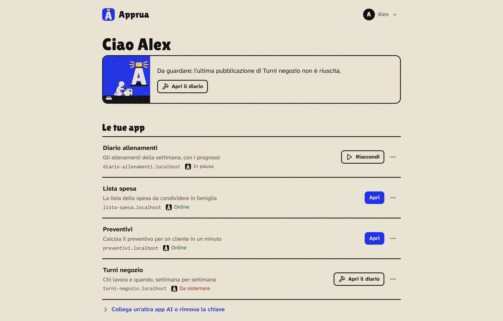

# Guida ad Apprua

*[English](../guide/README.md)*

Hai fatto un'app con l'AI e funziona: ora vuoi usarla davvero, dal telefono, con i colleghi, ogni giorno. Apprua è un posto sicuro, sul tuo PC o sul tuo server, dove le app fatte con l'AI ricevono un indirizzo vero, senza dover imparare Git, Docker, server o certificati. Le pubblichi con una frase alla tua app AI (Claude, Codex di OpenAI, Cursor, VS Code e le altre che supportano i connettori MCP):

> «Pubblica questa app su Apprua.»

## Perché esiste

Con l'AI chiunque può farsi una piccola app: una lista, un calcolo, uno strumento per il proprio gruppo. Poi però quelle app restano sparse in chat, cartelle e servizi che nessuno controlla. Le password finiscono nel codice, nessuno sa cosa gira, e quando chi l'ha fatta cambia lavoro l'app spesso sparisce.

Apprua le raccoglie in un posto solo, il tuo, con poche regole chiare:

- ogni app ha un **proprietario**, un **indirizzo** e la **storia delle sue versioni**;
- le **password restano fuori dal codice**: se l'AI prova a pubblicarle, Apprua si ferma;
- decidi tu **chi può aprire** ogni app;
- tutto gira **dove installi Apprua**: niente account da noi, niente dati che escono.

## Cosa ci sta e cosa no

Apprua gira su un PC o su un server piccolo, con tante app una accanto all'altra. Serve per le app che usano una persona o un gruppo, non per i grandi servizi.

| Ci sta bene | Non va bene per |
|---|---|
| Strumenti per te o per l'ufficio: liste, calcoli, moduli, cruscotti | Siti e servizi con migliaia di visitatori |
| Piccoli gestionali e archivi | Modelli di AI che girano in locale |
| Prototipi da far provare ad altre persone | Video da elaborare e database molto grandi |
| App usate da qualche decina di persone | Sul PC: app che devono funzionare anche a PC spento |

Ogni app ha la sua **memoria**, di solito da 512 MB a 2 GB, scelta da Apprua in base alla macchina. Se un'app ne ha bisogno, un amministratore può dargliene di più dalla sua pagina, fino a circa metà della memoria che c'è per le app (vedi [La pagina di un'app](ogni-giorno.md#la-pagina-di-unapp)).

## Scegli la tua strada

| Chi sei | Dove si installa | Da dove partire |
|---|---|---|
| Una persona che vuole tenere le sue app | Il tuo PC Windows | [Apprua sul tuo PC](pc.md) |
| Un team, uno studio, un'azienda | Un server Linux | [Apprua su un server](server.md) |

Poi, per tutti:

1. [Collegare la tua app AI](collegare.md): la chiave personale e i passi per Claude, Codex, Cursor, VS Code.
2. [Usare Apprua ogni giorno](ogni-giorno.md): le tue app, le versioni, i segreti, chi può aprirle.
3. [Problemi comuni](problemi.md): cosa fare quando qualcosa non va.

Per chi gestisce Apprua per altre persone: [Privacy](privacy.md), cosa tiene Apprua, per quanto tempo e come togliere un account su richiesta.

## Le parole che usiamo

| Parola | Cosa vuol dire |
|---|---|
| **Portale** | La pagina di Apprua che apri nel browser: lì vedi le tue app e crei la chiave |
| **App AI** | Il programma con cui parli con l'AI: Claude Desktop, Claude Code, Codex, Cursor, VS Code e altri |
| **Connettore** | Il piccolo pezzo che collega la tua app AI ad Apprua (usa lo standard MCP) |
| **Chiave personale** | Il codice che il connettore usa per entrare in Apprua al posto tuo. Inizia con `apr_` |
| **Segreto** | Una password o una chiave che l'app usa mentre funziona. Si dà ad Apprua, non si scrive nei file |
| **Motore** | Il programma open source ([Coolify](https://coolify.io)) che Apprua usa per far girare le app. Non devi mai aprirlo |

> La versione più recente e le novità sono nelle [release](https://github.com/apprua/apprua/releases) e nel [CHANGELOG](../../CHANGELOG.md). Se trovi qualcosa che non va, [aprici una segnalazione](https://github.com/apprua/apprua/issues).
