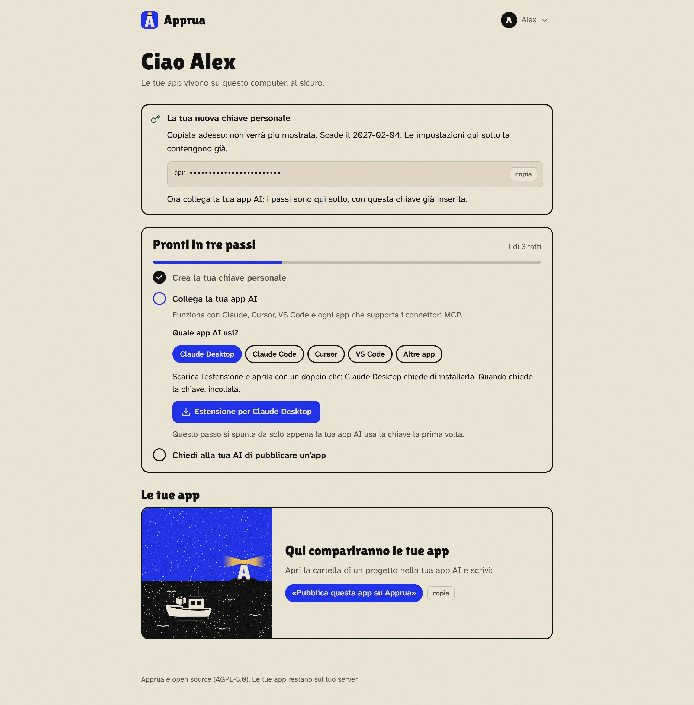

# Collegare la tua app AI

*[Torna alla guida](README.md) · [English](../guide/connect.md)*

La tua app AI parla con Apprua attraverso un **connettore** (usa MCP, lo standard aperto per collegare le app AI ad altri programmi). Il connettore gira sul tuo PC, perché deve leggere la cartella dell'app da pubblicare, ed entra in Apprua con la tua **chiave personale**.

## La chiave personale

Nel portale, primo passo: **Crea la chiave**. La chiave inizia con `apr_` e si vede **una volta sola**: i passi qui sotto, nel portale, la contengono già, quindi di solito non devi copiarla a mano.

- Dura **90 giorni**. Quando scade, crea una nuova chiave dal portale e ripeti il passo della tua app AI.
- È come una password: non metterla nei file dei progetti e non mandarla in chat. Se Apprua la trova in una cartella da pubblicare, rifiuta la pubblicazione.
- Se pensi che qualcuno l'abbia vista, crea una nuova chiave: la vecchia smette subito di funzionare.

## Scegli la tua app AI

Il portale mostra una scheda per ogni app. Ecco cosa fare in ognuna.

### Claude Desktop

1. Clicca **Estensione per Claude Desktop**: scarichi il file `apprua.mcpb`, con l'indirizzo del tuo Apprua già dentro.
2. Aprilo con un doppio clic: Claude Desktop chiede se vuoi installarla.
3. Quando chiede la chiave, incollala.

### Claude Code

Il portale ti dà un comando da incollare nel terminale, con la chiave già dentro (c'è una versione per Windows e una per macOS e Linux). Vale per tutti i tuoi progetti.

### Codex (di OpenAI, con GPT)

Codex è l'app di OpenAI per creare app con GPT, compresa nei piani di ChatGPT. Il portale ti dà poche righe da copiare in fondo al file `config.toml` di Codex, con la chiave già dentro (una versione per Windows e una per macOS e Linux). Il file sta nella cartella `.codex` della tua cartella utente: su Windows `%USERPROFILE%\.codex\config.toml`, su macOS e Linux `~/.codex/config.toml`; se non c'è, crealo. Poi chiudi e riapri Codex. Vale per l'app Codex, per Codex nel terminale e per l'estensione di Codex in VS Code. Chi usa Codex nel terminale può usare invece il comando che il portale mostra sotto "Se usi Codex nel terminale".

La chat di ChatGPT, sul sito o nell'app, per ora non può usare Apprua: accetta solo connettori raggiungibili da internet, mentre il connettore di Apprua gira sul tuo computer, perché deve leggere la cartella dell'app.

### Cursor e VS Code

Subito dopo aver creato la chiave compare il pulsante **Aggiungi a Cursor** (o **Aggiungi a VS Code**). Cliccalo: l'app si apre e chiede conferma, tu clicchi *Install*. Niente da copiare.

Se preferisci farlo a mano, sotto il pulsante ci sono le impostazioni da incollare nel file di configurazione MCP.

### Altre app

Ogni app che supporta i connettori MCP va bene: copia le impostazioni della scheda **Altre app** nella sua configurazione dei connettori.

**Node.js:** Claude Code, Codex, Cursor, VS Code e le altre app avviano il connettore con `npx`, che fa parte di Node.js (gratuito). Se l'app dice che non trova `npx`, installa Node.js da [nodejs.org](https://nodejs.org) e riavvia l'app. Claude Desktop non ne ha bisogno.

## Come sai che funziona

Il secondo passo del portale, *Collega la tua app AI*, si spunta da solo la prima volta che la tua app AI usa la chiave. Puoi provare chiedendo:

> «Quali app ho su Apprua?»

## Cosa puoi chiedere alla tua AI

Non servono parole speciali: basta dire cosa vuoi. Qualche esempio:

| Vuoi... | Puoi dire |
|---|---|
| Pubblicare un'app nuova | «Pubblica questa app su Apprua» |
| Pubblicare una nuova versione | «Aggiorna l'app su Apprua» |
| Capire perché non va | «Guarda il diario di turni-negozio su Apprua e sistemala» |
| Vedere cosa sta succedendo | «Fammi vedere cosa scrive lista-spesa mentre funziona» |
| Dare una password all'app | «Aggiungi a preventivi il segreto EMAIL_PASSWORD» (l'AI ti chiede il valore) |
| Decidere chi la apre | «Rendi lista-spesa visibile solo a me» |
| Tornare indietro | «Rimetti online la versione di ieri di lista-spesa» |
| Riprendere il codice su un altro PC | «Scarica il codice di lista-spesa in questa cartella» |
| Metterla in pausa o riaccenderla | «Metti in pausa diario-allenamenti» / «Riaccendila» |

Quando pubblichi la prima volta l'AI ti chiede tre cose: il **nome** dell'app (diventa il suo indirizzo, per esempio `lista-spesa`), **una riga** che dica a cosa serve, e se l'app **salva dati** (in quel caso i dati restano anche quando pubblichi una versione nuova).

**Prossimo passo:** [Usare Apprua ogni giorno](ogni-giorno.md)
