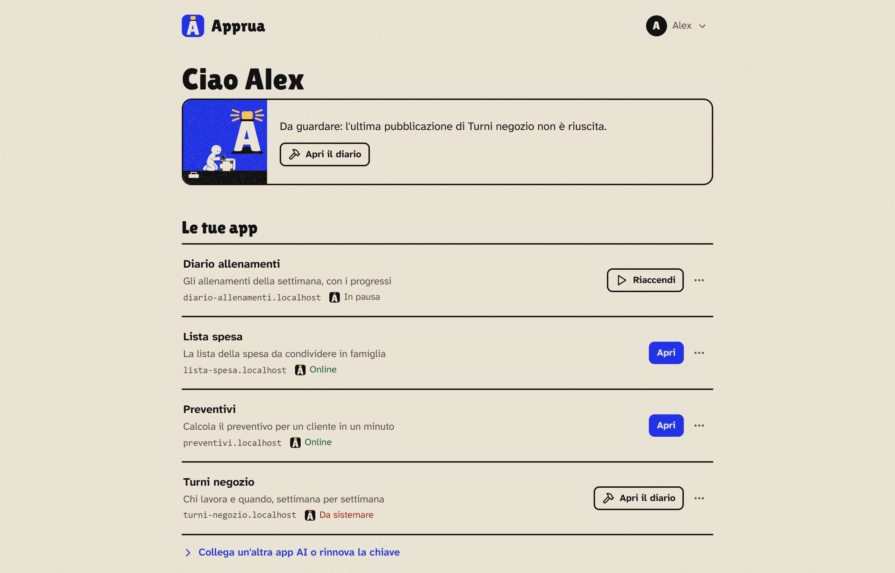
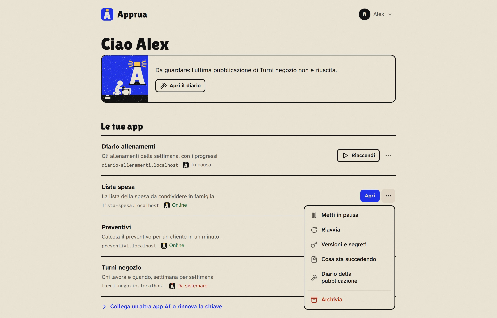
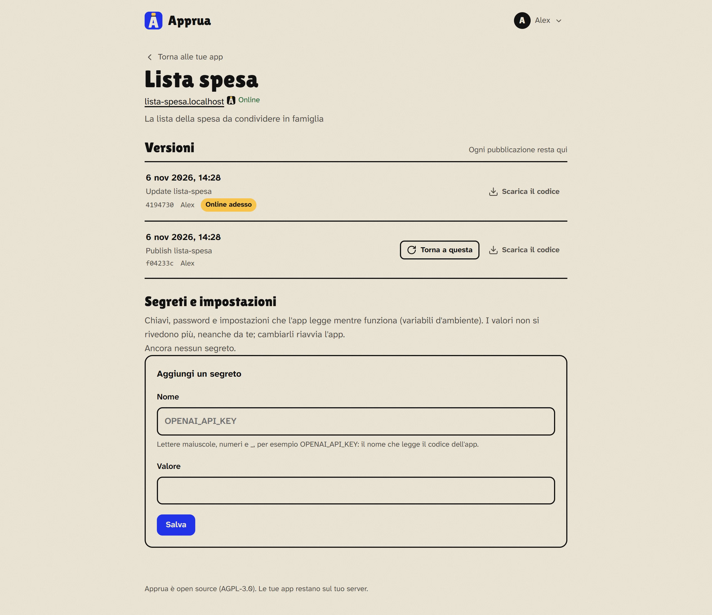
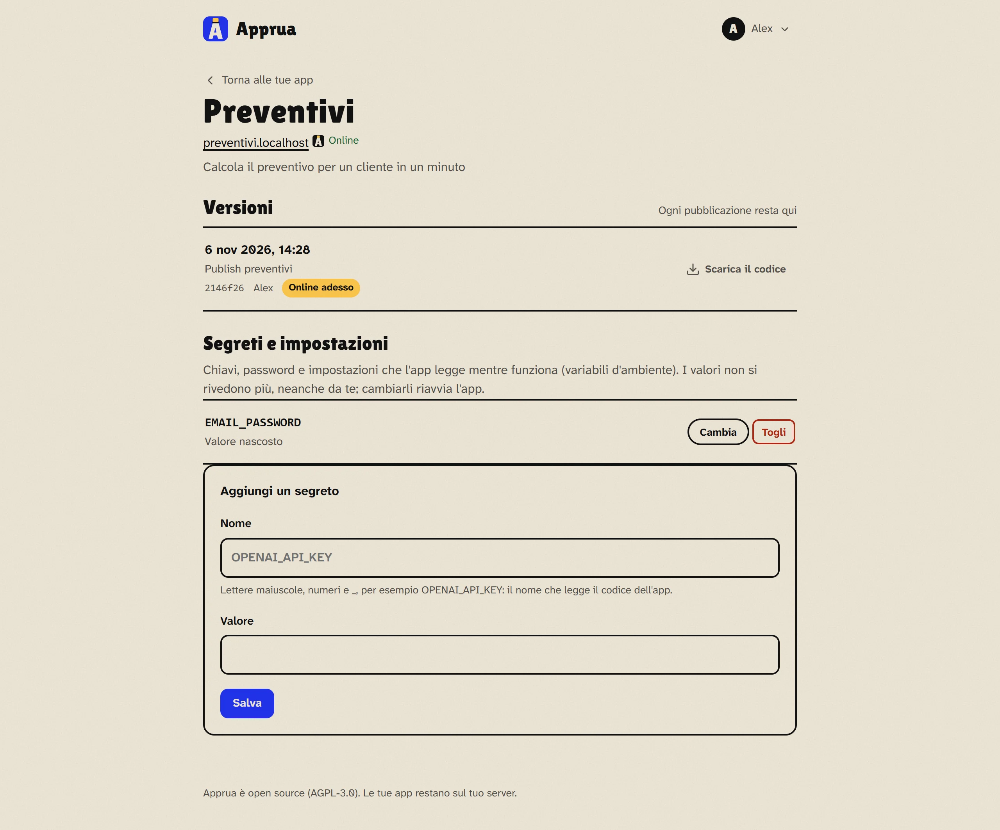
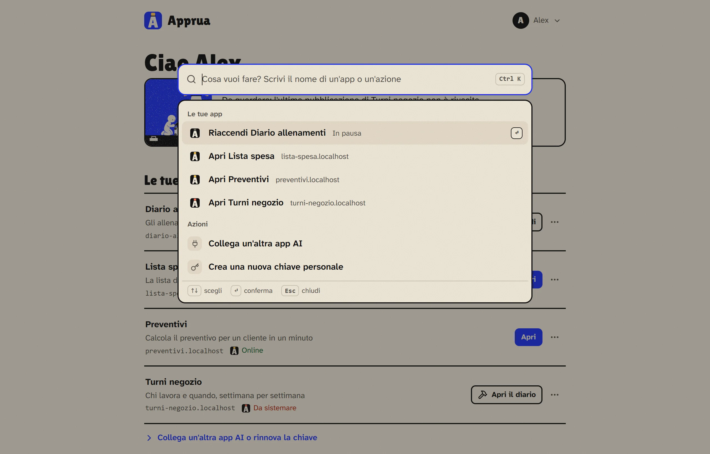
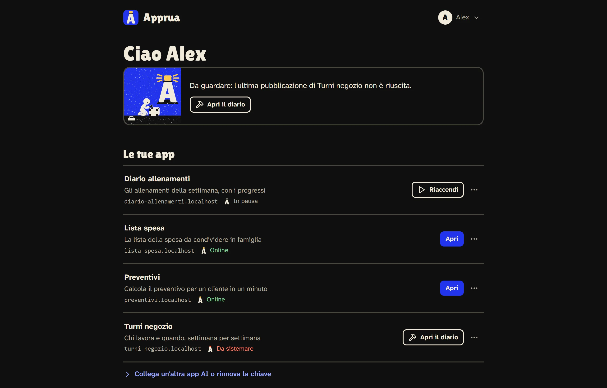
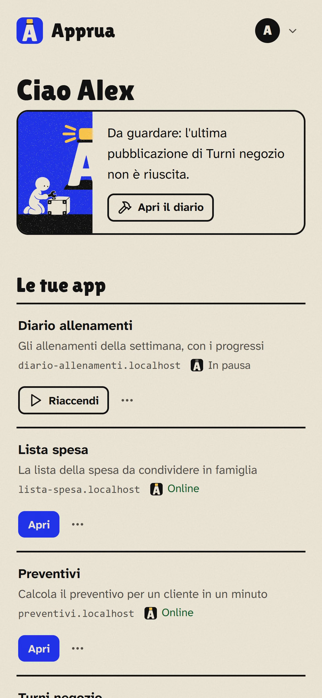

# Usare Apprua ogni giorno

*[Torna alla guida](README.md) · [English](../guide/everyday.md)*

## Le tue app

La pagina principale del portale mostra le tue app, una per riga: nome, a cosa serve, indirizzo e stato. Ogni riga ha **un solo pulsante**, quello che serve di più in quel momento, e il menu **⋯** per il resto.

Se qualcosa merita uno sguardo (per esempio una pubblicazione non riuscita), lo trovi scritto in alto. Quando è tutto a posto, il portale resta in silenzio.

## Il piccolo faro

Accanto allo stato di ogni app c'è un piccolo faro: la sua luce dice come sta l'app.

| Luce | Stato | Il pulsante della riga |
|---|---|---|
| Gialla | **Online**: l'app risponde al suo indirizzo | **Apri** |
| Gialla con il fascio che gira | **Si sta pubblicando** | |
| Grigia | **In pausa**: l'hai fermata tu, o non è stata confermata alla revisione | **Riaccendi** |
| Rossa | **Da sistemare**: l'ultima pubblicazione non è andata a buon fine | **Apri il diario** |
| Rossa | **Non risponde**: l'app dovrebbe essere accesa ma da qualche minuto non funziona (per esempio si è bloccata) | **Riavvia** |

Un'app in pausa non è un errore: è spenta e non usa memoria, ma codice e dati restano.

## Il menu ⋯

Dal menu di ogni app puoi:

- **Metti in pausa** e **Riavvia**. La pausa non chiede conferma: compare subito un *Annulla*;
- **Cosa sta succedendo**: quello che l'app scrive mentre funziona (utile per capire un problema);
- **Diario della pubblicazione**: cosa è successo mentre Apprua costruiva l'app;
- **Chi può aprirla**: *Solo tu*, *Chi ha un account* oppure *Tutti, senza accesso*. Vale subito. Compare quando le app si aprono dalla rete locale o da internet: se si aprono solo dal tuo PC non c'è niente da proteggere;
- **Versioni e segreti**: la pagina dell'app (qui sotto);
- **Serve ancora** (nei gruppi con revisione periodica): conferma che l'app è ancora utile;
- **Archivia**: l'app si ferma ed esce dall'elenco, ma codice e dati restano.

## La pagina di un'app

Clicca il nome di un'app per aprire la sua pagina.

**Versioni.** Ogni pubblicazione resta qui, con data e autore. Se una versione nuova non va, **Torna a questa** rimette online una di prima (diventa la più recente e le altre restano). **Scarica il codice** ti dà lo ZIP di quella versione.

**Segreti e impostazioni.** Password, chiavi e impostazioni che l'app legge mentre funziona. Vedi solo i nomi, mai i valori, nemmeno tu: puoi aggiungerne, cambiarli o toglierli, e ogni volta l'app si riavvia con i valori nuovi.

**Memoria.** Quanta memoria può usare l'app. Alla maggior parte delle app bastano da 256 MB a 1 GB. Un amministratore la cambia da qui con **Salva e riavvia l'app**: l'app riparte subito con la memoria nuova. Il massimo dipende dalla macchina: circa metà della memoria che c'è per le app (2 GB su una macchina da 8 GB, 4 GB su una da 16 GB, 8 GB su una da 32 GB). La pagina dice anche quanta memoria possono usare insieme le app accese, perché più memoria a un'app lascia meno spazio alle altre.

**Quando un'app finisce la memoria.** Se un'app supera la sua memoria, il sistema deve fermarla, del tutto o in parte, e chi la stava usando può perdere quello che stava facendo. Apprua se ne accorge: nell'elenco compare **Ha finito la memoria**, la pagina dell'app lo spiega in cima e, se Apprua può mandare email, il proprietario riceve un messaggio. Le strade sono due: darle più memoria, oppure chiedere alla tua AI di farle usare meno memoria. L'avviso sparisce quando cambi la memoria o pubblichi una versione nuova.

## Cosa controlla Apprua quando pubblichi

- **Niente segreti nei file.** Se la cartella contiene password, chiavi API, file `.env` o chiavi private, la pubblicazione viene rifiutata e Apprua spiega quali file sono. La soluzione: toglierli dai file e darli all'app come segreti (l'AI lo sa fare).
- **App nate dentro una chat.** Alcune app create nelle chat AI usano funzioni che esistono solo lì (per esempio salvare dati nella chat). Apprua le pubblica ma avvisa che fuori dalla chat potrebbero non funzionare.
- **Mai una copia vecchia sopra una nuova.** Se l'app è stata aggiornata da un altro PC, Apprua non la sovrascrive: l'AI prima scarica l'ultima versione, poi applica le modifiche.

## Comandi rapidi

Premi **Ctrl K** (o **/**) in qualunque pagina del portale: si apre una barra dove scrivi cosa vuoi fare, per esempio "pausa", "lista" o "chiave", e scegli con le frecce e Invio.

## Chiaro, scuro, telefono

Dal menu del tuo account (in alto a destra) cambi lingua e tema. Il portale funziona anche sul telefono.

| Tema scuro | Sul telefono |
|---|---|
|  |  |

## Il tuo account e la password

Dal menu del tuo account (in alto a destra) apri **Il tuo account**: lì cambi la password scrivendo prima quella attuale. Ogni altro dispositivo entrato con la password vecchia dovrà rientrare: è utile anche se pensi che qualcuno l'abbia vista.

**Password dimenticata?** Nella pagina di accesso c'è il collegamento. Se Apprua può mandare email, arriva un link valido un'ora per sceglierne una nuova; altrimenti un amministratore ti dà una nuova password (vedi [Problemi comuni](problemi.md#hai-dimenticato-la-password)).

**Se qualcosa non va:** [Problemi comuni](problemi.md)
