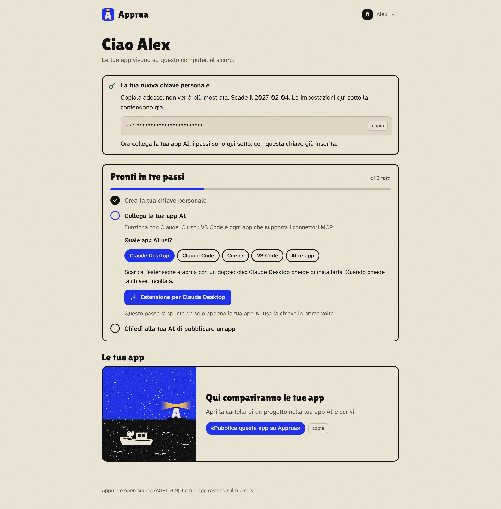
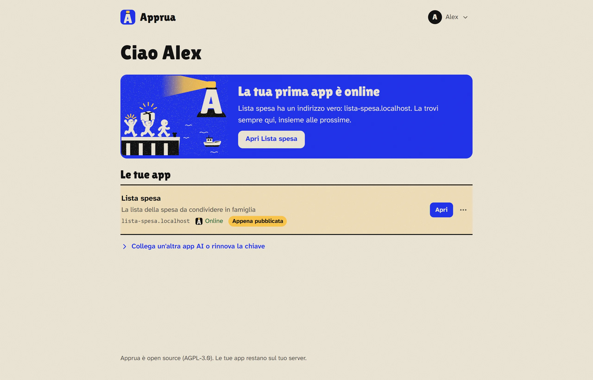

# Apprua sul tuo PC Windows

*[Torna alla guida](README.md) · [English](../guide/pc.md)*

Apprua si installa dentro un piccolo Linux nascosto di Windows (si chiama WSL). Non serve Docker Desktop e non devi sapere niente di Linux: fa tutto l'installazione.

## Cosa ti serve

| | |
|---|---|
| Sistema | Windows 11, oppure Windows 10 versione 2004 o più recente |
| Memoria | almeno 8 GB (meglio 16). Apprua ne usa metà, tra 4 e 16 GB |
| Disco | almeno 15 GB liberi su C: |
| Virtualizzazione | accesa nel BIOS (di solito lo è già; se non lo è, l'installazione te lo dice) |
| Internet | sì, durante l'installazione |

## 1. Scarica Apprua

1. Apri la pagina dell'[ultima versione di Apprua](https://github.com/apprua/apprua/releases/latest).
2. Sotto *Assets* clicca **apprua.zip**.
3. Apri il file scaricato ed **estrai** la cartella, per esempio in `Documenti\apprua`.

## 2. Avvia l'installazione

1. Apri la cartella `apprua` che hai estratto.
2. Clicca con il tasto destro su uno spazio vuoto della cartella e scegli **Apri nel terminale** (su Windows 10: tieni premuto Maiusc, tasto destro, *Apri finestra PowerShell qui*).
3. Copia questo comando, incollalo nel terminale e premi Invio:

```powershell
powershell -ExecutionPolicy Bypass -File install\windows\install-apprua.ps1
```

La prima volta ci vogliono **da 10 a 20 minuti**: l'installazione scarica il Linux, il motore e Apprua. Puoi lasciarla lavorare. Alla fine il portale si apre da solo nel browser.

**Due casi particolari:**

- **Se WSL non c'è ancora**, l'installazione lo dice. Chiudi il terminale, aprine uno **come amministratore** (tasto destro sul menu Start, *Terminale (amministratore)*), vai nella cartella `apprua` e rilancia lo stesso comando. Quando te lo chiede, riavvia il PC e lancialo un'ultima volta (se chiede di nuovo l'amministratore, apri ancora il terminale come amministratore: su alcuni PC Windows non finisce da solo di installare WSL, e l'installazione lo completa).
- **Se sul PC c'è già Docker Desktop** o un altro Linux con Docker, l'installazione ti avvisa: due Docker accesi insieme possono togliersi la rete a vicenda. Meglio tenere spento l'altro mentre usi Apprua. Se le app smettono di rispondere, rilancia l'installazione: ripara la rete e tiene app e dati.

## 3. La prima configurazione

Il portale fa una sola domanda: per chi è questo Apprua. Su un PC scegli **Solo per me**.


Poi crei il tuo account: un nome (se vuoi), la tua email e una password di almeno 10 caratteri. L'email serve solo per entrare: Apprua non manda niente a nessuno.


## 4. Crea la chiave e collega la tua app AI

Il portale ti accompagna in tre passi. Il primo è creare la tua **chiave personale**: un clic su *Crea la chiave*.


Subito sotto compaiono i passi per la tua app AI, con la chiave già dentro. Scegli quella che usi e segui le istruzioni: i dettagli sono in [Collegare la tua app AI](collegare.md).



## 5. Pubblica la tua prima app

Apri nella tua app AI la cartella del progetto (o la chat dove l'hai creata) e scrivi:

> «Pubblica questa app su Apprua.»

L'AI ti chiede il nome dell'app e una riga che dica a cosa serve, poi la pubblica. Dopo un po' (di solito qualche minuto, dipende dall'app) ti risponde con l'indirizzo, per esempio `http://lista-spesa.localhost`, e nel portale il faro si accende:



Per una nuova versione basta dire: «Aggiorna l'app su Apprua».

## Dove trovi Apprua dopo

- **Icona Apprua** sul desktop e nel menu Start: apre il portale (e accende Apprua se era spento).
- **Icona vicino all'orologio**: il faro acceso quando Apprua funziona, il faro spento mentre parte, grigia quando non è in funzione. Con il tasto destro puoi aprire, riavviare, fermare o avviare Apprua, e scegliere se farlo partire con Windows.
- Apprua parte da solo quando accedi a Windows. Se vuoi liberare memoria, dall'icona vicino all'orologio scegli **Arresta Apprua**.

## Aprire le app agli altri PC della rete

All'inizio le app si aprono solo da questo PC. Puoi aprirle anche ai colleghi dell'ufficio o a chi è in casa con te (ma non da internet). Serve un **nome** che la tua rete conosce già, per esempio `app.tuaazienda.it`: i nomi sono tuoi, Apprua non li crea e non usa servizi esterni per farli funzionare.

1. **Il nome nel DNS.** Chi gestisce la rete aggiunge due righe al DNS (quello dell'azienda, del router, o del tuo dominio): `apprua.app.tuaazienda.it` e `*.app.tuaazienda.it`, tutte e due verso l'indirizzo di questo PC (per esempio `192.168.1.20`). Conviene dare anche un **indirizzo fisso** al PC.
2. **Rilancia l'installazione con quel nome:**

   ```powershell
   powershell -ExecutionPolicy Bypass -File install\windows\install-apprua.ps1 -Network lan -Domain app.tuaazienda.it
   ```

3. **Controlla:** nel portale, *Impostazioni > Da dove si aprono le app > Verifica* dice se i nomi portano davvero a questo PC, anche provando dal dispositivo che stai usando.

Windows chiede una volta il permesso di amministratore per aprire le porte 80 e 443. Da quel momento il portale è su `http://apprua.app.tuaazienda.it` e le app su `http://<nome>.app.tuaazienda.it`, uguali per tutti. Chi apre un'app deve entrare con un account (a meno che tu non scelga *Tutti, senza accesso* per quell'app).

**HTTPS (facoltativo).** Senza HTTPS il browser scrive "Non sicuro", dagli altri dispositivi le app non possono usare fotocamera, microfono e posizione, e quello che passa sulla rete (gli accessi, le chiavi personali delle app AI) non è cifrato: va bene su una rete di casa o dell'ufficio di cui ti fidi, non su una rete condivisa. Il portale te lo ricorda dove si usa la chiave. Per l'HTTPS serve un **certificato per `*.app.tuaazienda.it`** (dall'azienda o comprato, due file PEM: il certificato e la sua chiave). Procurarlo e rinnovarlo tocca a te; Apprua lo controlla e lo usa per il portale e per tutte le app:

```powershell
powershell -ExecutionPolicy Bypass -File install\windows\install-apprua.ps1 -Network lan -Cert C:\certificati\cert.pem -CertKey C:\certificati\chiave.pem
```

Le Impostazioni mostrano quando scade e avvisano quando mancano meno di 30 giorni. Per un certificato rinnovato: stesso comando con i file nuovi. Per tornare a http: `-Network lan -Https off`.

Da sapere:

- la rete deve essere impostata come **Privata** in Windows (*Impostazioni > Rete e Internet*): su una rete pubblica le porte restano chiuse;
- se il router cambia l'indirizzo del PC, i nomi nel DNS portano al posto sbagliato: per questo serve l'indirizzo fisso.

Per tornare a *solo questo PC*: `-Network local`.

## Copie, memoria e disinstallazione

Tutti i comandi si lanciano dalla cartella `apprua`, come l'installazione.

| Cosa vuoi fare | Comando |
|---|---|
| Fare una copia completa (app, dati, codice) | `powershell -ExecutionPolicy Bypass -File install\windows\install-apprua.ps1 -Backup` |
| Rimettere tutto da una copia | `powershell -ExecutionPolicy Bypass -File install\windows\install-apprua.ps1 -RestoreFrom <file.tar>` |
| Dare più (o meno) memoria ad Apprua | `powershell -ExecutionPolicy Bypass -File install\windows\install-apprua.ps1 -SetMemoryGB 12` |
| Aggiornare Apprua (tiene app e dati) | scarica `apprua.zip` dall'[ultima versione](https://github.com/apprua/apprua/releases/latest), estrailo al posto del vecchio e rilancia l'installazione |
| Togliere Apprua | *Impostazioni > App > App installate*, cerca **Apprua**, poi **Disinstalla**. Oppure: `powershell -ExecutionPolicy Bypass -File install\windows\install-apprua.ps1 -Uninstall` |

Le copie finiscono in `Apprua-backups`, nella tua cartella utente. Durante una copia le app restano spente qualche minuto. Una copia contiene tutti i dati e i segreti delle app, **non cifrati**: tienila dove solo tu puoi leggerla. Accanto c'è un file `.sha256`, la sua impronta: tienilo insieme alla copia, il ripristino lo controlla e rifiuta una copia danneggiata o cambiata. La disinstallazione ti propone prima una copia, poi ti chiede di scrivere `ELIMINA`: toglie il Linux "Apprua", le icone e l'avvio automatico. WSL e gli altri Linux del PC non si toccano mai.

## Da sapere

- **Le tue app vivono in un Linux nascosto di Windows chiamato "Apprua"** (WSL). Se togli WSL da Windows, o cancelli quel Linux (per esempio con `wsl --unregister Apprua`), si cancellano anche **tutte le app e i loro dati**. Per togliere Apprua usa sempre *Impostazioni > App*: ti propone prima una copia.
- **A PC spento le app sono spente.** Si riaccendono da sole quando accedi a Windows. Se servono sempre, anche quando spegni il PC, meglio un server ([Apprua su un server](server.md)).
- **Fai una copia ogni tanto** (vedi la tabella qui sopra) e tienila anche fuori dal PC, per esempio su una chiavetta.
- **La cartella in cui hai estratto Apprua** serve per i comandi di questa pagina. Se l'hai cancellata, scarica di nuovo `apprua.zip`: app e dati non sono lì dentro.
- **Se chiudi per sbaglio la prima configurazione**, apri l'icona **Apprua**: riparte dal punto in cui eri.
- **Se chiudi per sbaglio la finestra dell'installazione**, rilanciala: riprende e tiene quello che c'è già.

**Prossimo passo:** [Collegare la tua app AI](collegare.md)
