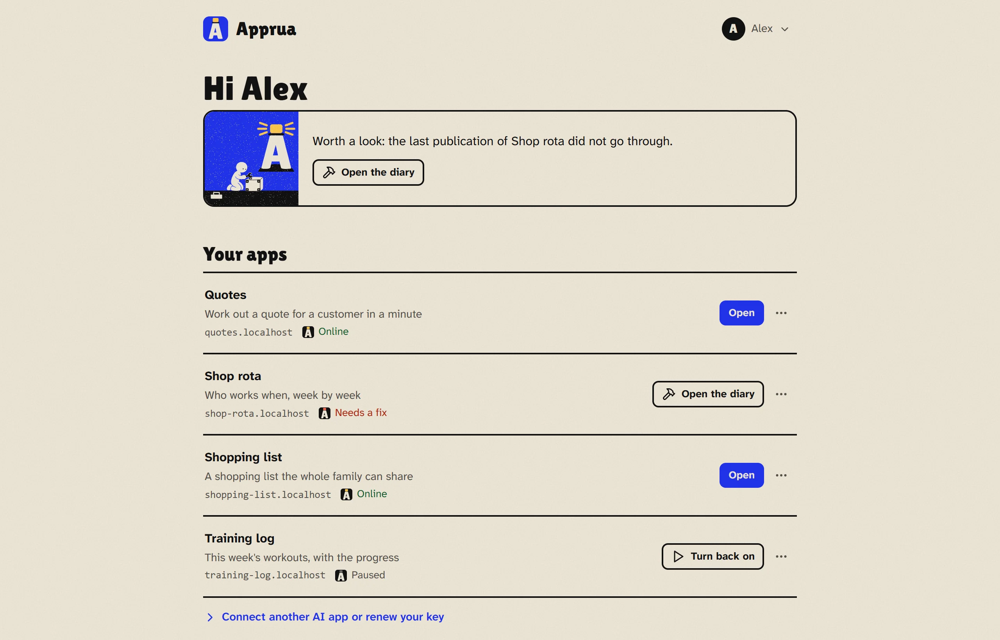

# The Apprua guide

*[Italiano](../guida/README.md)*

You built an app with AI and it works: now you want to really use it, from your phone, with your team, every day. Apprua is a safe place, on your own PC or server, where the apps you build with AI get a real address, without learning Git, Docker, servers or certificates. You publish them with one sentence to your AI app (Claude, OpenAI Codex, Cursor, VS Code and the others that support MCP connectors):

> "Publish this app on Apprua."

## Why it exists

With AI anyone can build a small app: a list, a calculator, a tool for their team. But then those apps end up scattered across chats, folders and services nobody looks after. Passwords end up in the code, nobody knows what is running, and when the person who made it moves on, the app often goes too.

Apprua gathers them in one place, your own, with a few clear rules:

- every app has an **owner**, an **address** and a **history of its versions**;
- **passwords stay out of the code**: if the AI tries to publish them, Apprua stops;
- you decide **who can open** each app;
- everything runs **where you install it**: no account with us, no data leaving.

## What fits and what does not

Apprua runs on a PC or a small server, with many apps side by side. It is meant for apps used by one person or a group, not for big services.

| A good fit | Not made for |
|---|---|
| Tools for you or your office: lists, calculators, forms, dashboards | Sites and services with thousands of visitors |
| Small management tools and archives | AI models running locally |
| Prototypes for other people to try | Video processing and very large databases |
| Apps used by a few dozen people | On a PC: apps that must keep working when the PC is off |

Every app has its own **memory**, usually from 512 MB to 2 GB, chosen by Apprua from the machine. When an app needs more, an administrator can give it more on its page, up to about half of the memory there is for apps (see [An app's page](everyday.md#an-apps-page)).

## Choose your path

| Who you are | Where it goes | Start here |
|---|---|---|
| One person who wants a home for their apps | Your Windows PC | [Apprua on your PC](pc.md) |
| A team, a studio, a company | A Linux server | [Apprua on a server](server.md) |

Then, for everyone:

1. [Connect your AI app](connect.md): your personal key and the steps for Claude, Codex, Cursor, VS Code.
2. [Using Apprua every day](everyday.md): your apps, versions, secrets, who can open them.
3. [Common problems](problems.md): what to do when something goes wrong.

For whoever runs Apprua for other people: [Privacy](privacy.md), what Apprua keeps, for how long, and how to remove an account on request.

## The words we use

| Word | What it means |
|---|---|
| **Portal** | The Apprua page you open in the browser: you see your apps there and create your key |
| **AI app** | The program you talk to the AI with: Claude Desktop, Claude Code, Codex, Cursor, VS Code and others |
| **Connector** | The small piece that links your AI app to Apprua (it uses the MCP standard) |
| **Personal key** | The code the connector uses to get into Apprua on your behalf. It starts with `apr_` |
| **Secret** | A password or key the app uses while it runs. It is given to Apprua, never written in the files |
| **Engine** | The open source program ([Coolify](https://coolify.io)) Apprua uses to run the apps. You never need to open it |

> The latest version and what changed are in the [releases](https://github.com/apprua/apprua/releases) and in the [CHANGELOG](../../CHANGELOG.md). If something is not right, [open an issue](https://github.com/apprua/apprua/issues).
