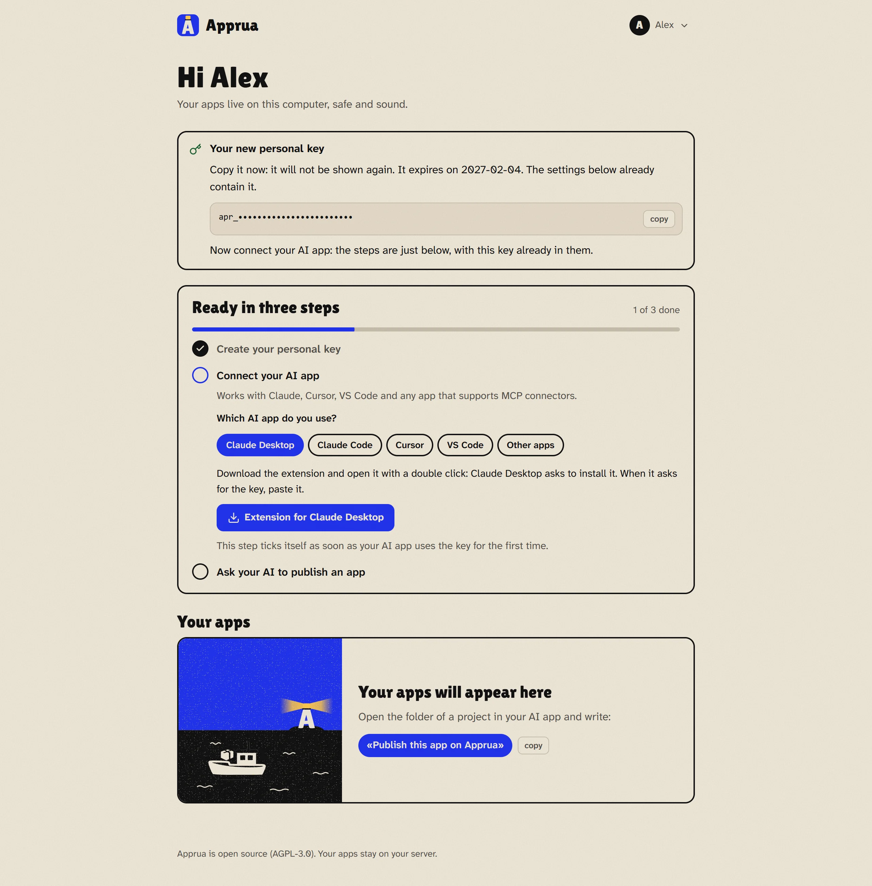

# Connect your AI app

*[Back to the guide](README.md) · [Italiano](../guida/collegare.md)*

Your AI app talks to Apprua through a **connector** (it uses MCP, the open standard for linking AI apps to other programs). The connector runs on your PC, because it has to read the app folder it publishes, and it gets into Apprua with your **personal key**.

## Your personal key

In the portal, step one: **Create the key**. The key starts with `apr_` and is shown **only once**: the steps below it in the portal already contain it, so you usually do not copy it by hand.

- It lasts **90 days**. When it expires, create a new key in the portal and repeat the step for your AI app.
- Treat it like a password: never put it in project files or send it in a chat. If Apprua finds it in a folder to publish, it refuses the publication.
- If you think someone saw it, create a new key: the old one stops working at once.

## Pick your AI app

The portal has a tab for each app. Here is what to do in each.

### Claude Desktop

1. Click **Extension for Claude Desktop**: you download the file `apprua.mcpb`, with your Apprua's address already in it.
2. Open it with a double click: Claude Desktop asks whether to install it.
3. When it asks for the key, paste it.

### Claude Code

The portal gives you a command to paste in the terminal, with the key already in it (one version for Windows, one for macOS and Linux). It works in all your projects.

### Codex (by OpenAI, with GPT)

Codex is the app of OpenAI for building apps with GPT, included in the ChatGPT plans. The portal gives you a few lines to copy at the end of the `config.toml` file of Codex, with the key already in them (one version for Windows, one for macOS and Linux). The file is in the `.codex` folder of your user folder: `%USERPROFILE%\.codex\config.toml` on Windows, `~/.codex/config.toml` on macOS and Linux; if it is not there, create it. Then close Codex and open it again. It works for the Codex app, Codex in the terminal and the Codex extension for VS Code. If you use Codex in the terminal you can use the command the portal shows under "If you use Codex in the terminal" instead.

The ChatGPT chat, on the website or in its app, cannot use Apprua for now: it only takes connectors reachable from the internet, while the connector of Apprua runs on your computer, because it reads the folder of the app.

### Cursor and VS Code

Right after you create the key, the button **Add to Cursor** (or **Add to VS Code**) appears. Click it: the app opens and asks you to confirm, you click *Install*. Nothing to copy.

If you prefer to do it by hand, the settings to paste into the MCP configuration file are right below the button.

### Other apps

Any app that supports MCP connectors works: copy the settings from the **Other apps** tab into its connectors configuration.

**Node.js:** Claude Code, Codex, Cursor, VS Code and the other apps start the connector with `npx`, which comes with Node.js (free). If the app says it cannot find `npx`, install Node.js from [nodejs.org](https://nodejs.org) and restart the app. Claude Desktop does not need it.

## How you know it works

Step two in the portal, *Connect your AI app*, ticks itself the first time your AI app uses the key. You can try by asking:

> "Which apps do I have on Apprua?"

## What you can ask your AI

No special words needed: just say what you want. A few examples:

| You want to... | You can say |
|---|---|
| Publish a new app | "Publish this app on Apprua" |
| Publish a new version | "Update the app on Apprua" |
| Understand why it fails | "Look at the diary of shop-rota on Apprua and fix it" |
| See what is going on | "Show me what shopping-list writes while it runs" |
| Give the app a password | "Add the secret EMAIL_PASSWORD to quotes" (the AI asks you for the value) |
| Decide who opens it | "Make shopping-list visible only to me" |
| Go back | "Put yesterday's version of shopping-list back online" |
| Get the code on another PC | "Download the code of shopping-list into this folder" |
| Pause it or turn it back on | "Pause training-log" / "Turn it back on" |

The first time you publish, the AI asks three things: the app's **name** (it becomes its address, for example `shopping-list`), **one line** about what it does, and whether the app **stores data** (if so, the data stays when you publish a new version).

**Next:** [Using Apprua every day](everyday.md)
