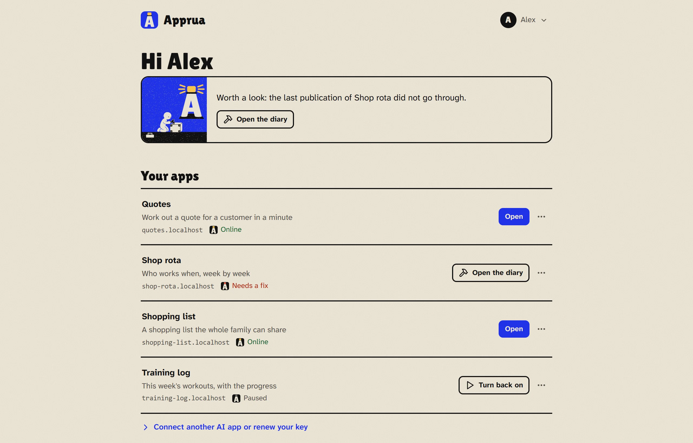
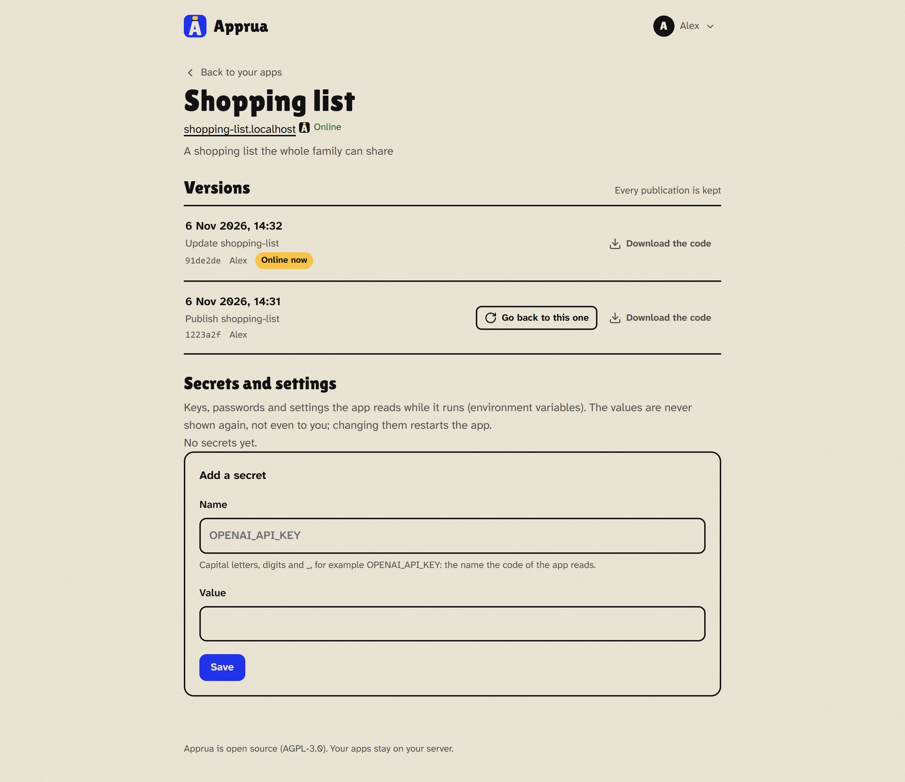
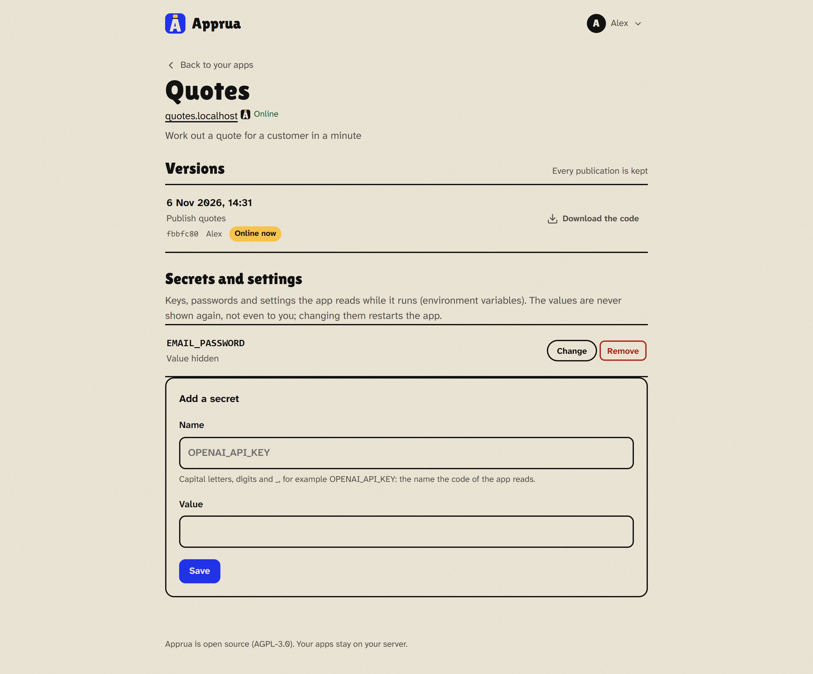
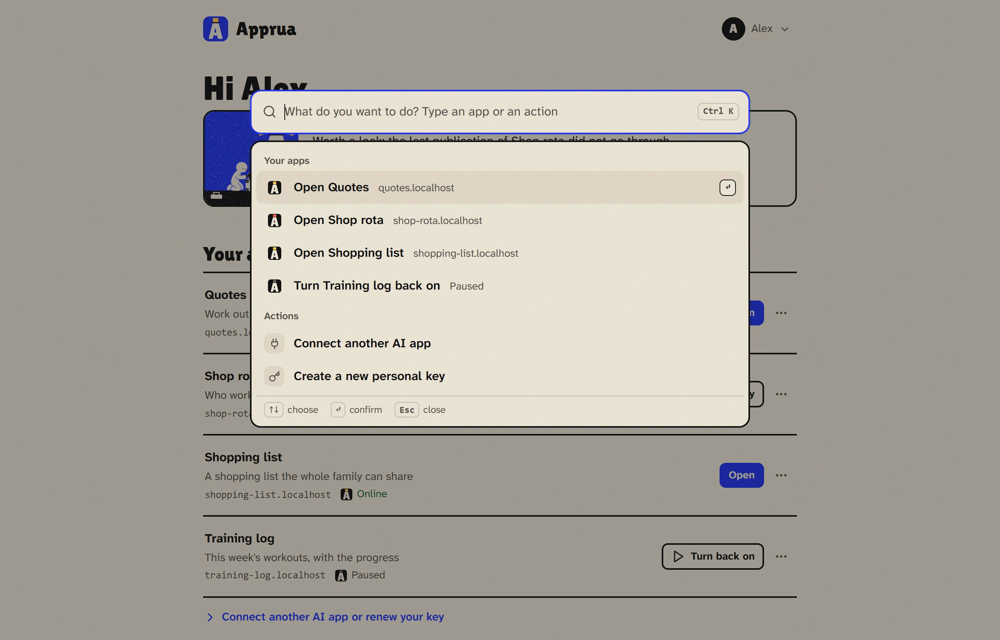
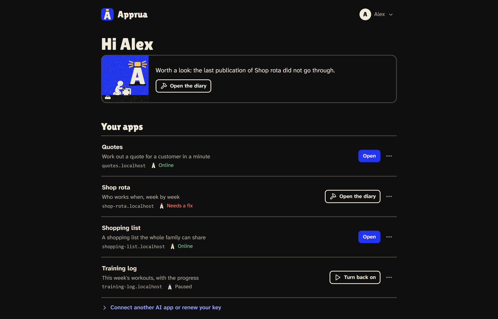
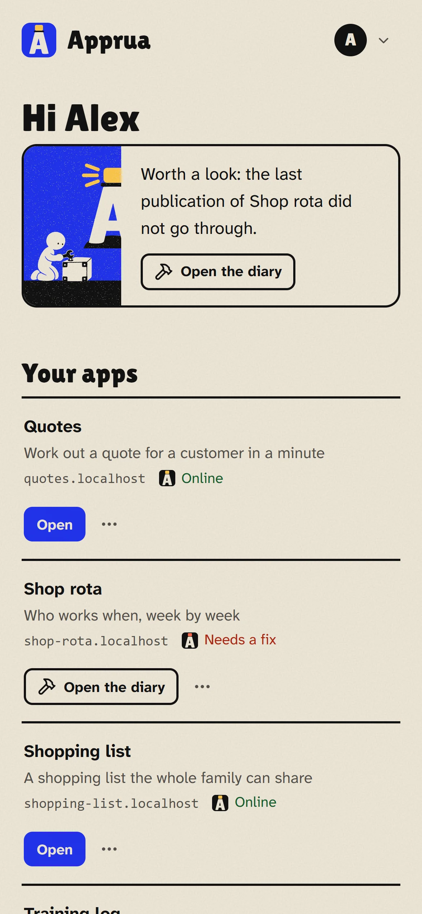

# Using Apprua every day

*[Back to the guide](README.md) · [Italiano](../guida/ogni-giorno.md)*

## Your apps

The main page of the portal shows your apps, one per row: name, what it is for, address and state. Each row has **one button**, the one you need most right then, and the **⋯** menu for the rest.

If something is worth a look (for example a publication that did not go through), it is written at the top. When all is well, the portal stays quiet.

## The tiny lighthouse

Next to each app's state there is a tiny lighthouse: its light tells you how the app is.

| Light | State | The row's button |
|---|---|---|
| Yellow | **Online**: the app answers at its address | **Open** |
| Yellow with a sweeping beam | **Publishing** | |
| Grey | **Paused**: you stopped it, or it was not confirmed at review time | **Turn back on** |
| Red | **Needs a fix**: the last publication did not go through | **Open the diary** |
| Red | **Not answering**: the app should be on but for a few minutes it has not been running (it crashed, for example) | **Restart** |

A paused app is not an error: it is off and uses no memory, but code and data stay.

## The ⋯ menu

From each app's menu you can:

- **Pause** and **Restart**. Pausing asks nothing: an *Undo* appears right away;
- **What's happening**: what the app writes while it runs (useful to understand a problem);
- **Publishing diary**: what happened while Apprua built the app;
- **Who can open it**: *Only you*, *Everyone with an account* or *Anyone, no sign-in*. It applies at once. It shows when the apps open from the local network or the internet: when they open only on your PC there is nothing to protect;
- **Versions and secrets**: the app's page (below);
- **Still needed** (in groups with periodic reviews): confirm the app is still useful;
- **Archive**: the app stops and leaves the list, but code and data stay.

## An app's page

Click an app's name to open its page.

**Versions.** Every publication stays here, with date and author. If a new version does not work, **Go back to this one** puts an earlier one back online (it becomes the newest, the others stay). **Download the code** gives you that version as a ZIP.

**Secrets and settings.** Passwords, keys and settings the app reads while it runs. You see only the names, never the values, not even you: you can add, change or remove them, and each time the app restarts with the new values.

**Memory.** How much memory the app can use. Most apps need from 256 MB to 1 GB. An administrator changes it here with **Save and restart the app**: the app starts again at once with the new memory. The most depends on the machine: about half of the memory there is for apps (2 GB on an 8 GB machine, 4 GB on 16 GB, 8 GB on 32 GB). The page also says how much memory the apps that are on can use together, because more memory for one app leaves less room for the others.

**When an app runs out of memory.** If an app goes over its memory, the system has to stop it, all or in part, and whoever was using it may lose what they were doing. Apprua notices: the list shows **Ran out of memory**, the page of the app explains it at the top and, if Apprua can send emails, the owner gets a message. There are two ways out: give it more memory, or ask your AI to make it use less. The notice goes away when you change the memory or publish a new version.

## What Apprua checks when you publish

- **No secrets in the files.** If the folder contains passwords, API keys, `.env` files or private keys, the publication is refused and Apprua says which files. The fix: take them out of the files and give them to the app as secrets (the AI knows how).
- **Apps born inside a chat.** Some apps made in AI chats use features that exist only there (for example saving data in the chat). Apprua publishes them but warns that outside the chat they may not work.
- **Never an old copy over a new one.** If the app was updated from another PC, Apprua does not overwrite it: the AI first downloads the latest version, then applies the changes.

## Quick commands

Press **Ctrl K** (or **/**) on any page of the portal: a bar opens where you type what you want to do, for example "pause", "shopping" or "key", and pick with the arrows and Enter.

## Light, dark, phone

From your account menu (top right) you switch language and theme. The portal works on your phone too.

| Dark theme | On a phone |
|---|---|
|  |  |

## Your account and password

From your account menu (top right) open **Your account**: there you change your password, typing the current one first. Every other device signed in with the old password has to sign in again: useful also if you think someone saw it.

**Forgot your password?** The sign-in page has the link. If Apprua can send emails, a link valid for one hour arrives to choose a new one; otherwise an administrator gives you a new password (see [Common problems](problems.md#you-forgot-your-password)).

**If something goes wrong:** [Common problems](problems.md)
