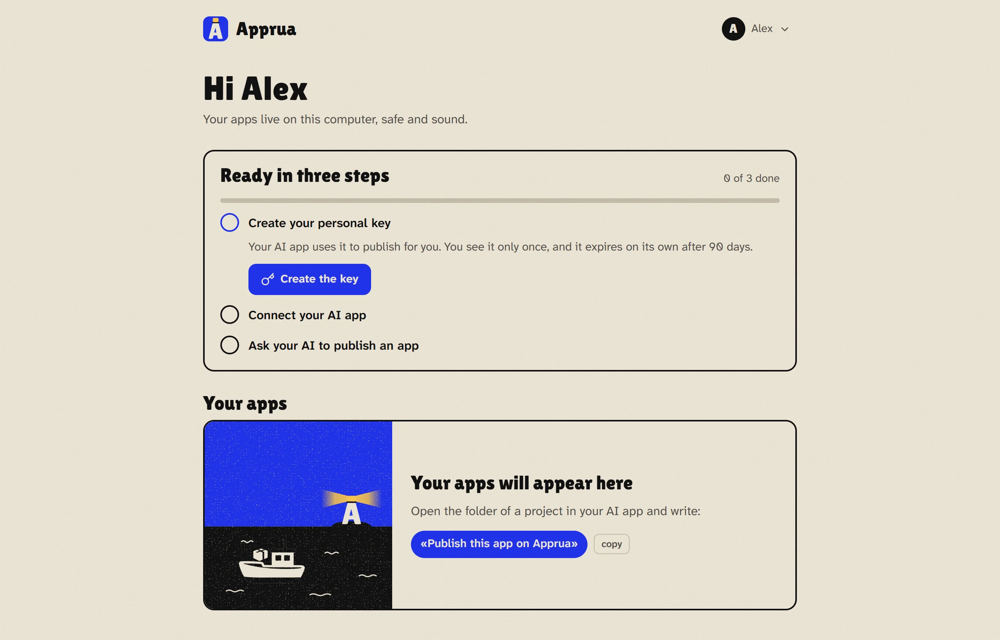
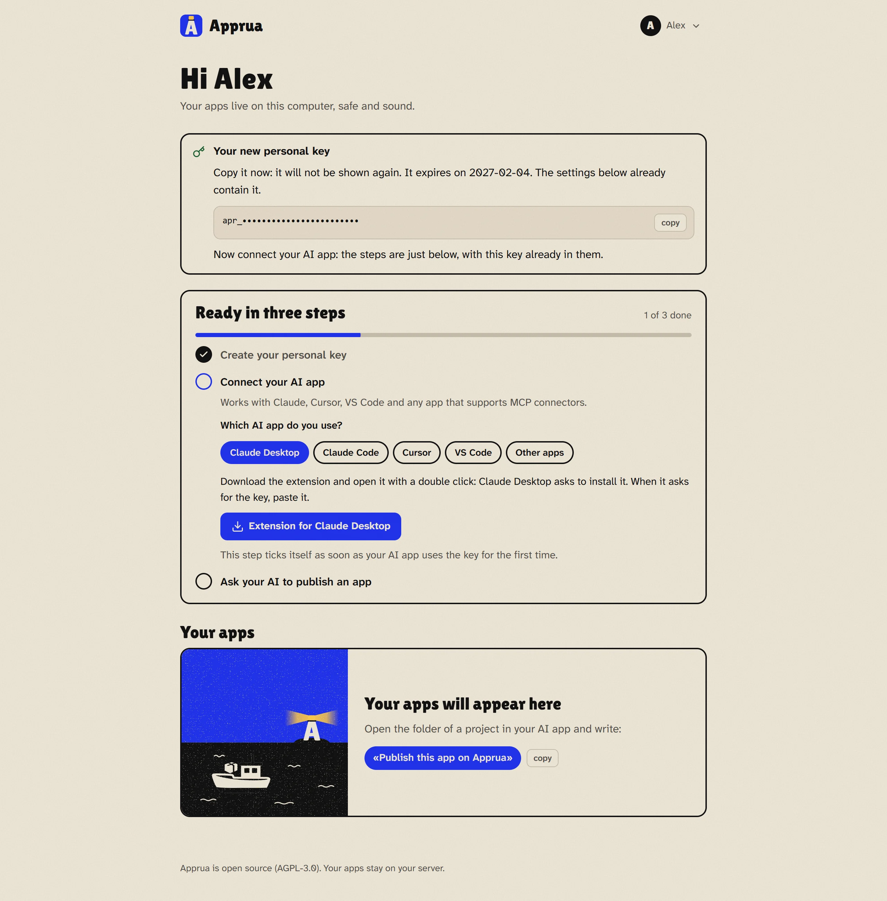
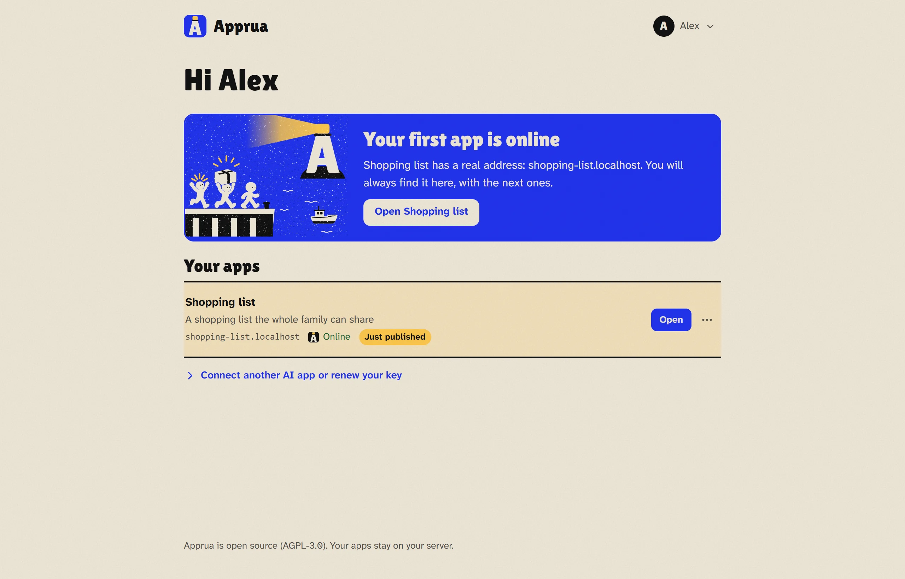

# Apprua on your Windows PC

*[Back to the guide](README.md) · [Italiano](../guida/pc.md)*

Apprua installs inside a small hidden Linux that Windows provides (it is called WSL). You do not need Docker Desktop and you do not need to know anything about Linux: the installer does it all.

## What you need

| | |
|---|---|
| System | Windows 11, or Windows 10 version 2004 or newer |
| Memory | at least 8 GB (16 is better). Apprua uses half of it, between 4 and 16 GB |
| Disk | at least 15 GB free on C: |
| Virtualization | turned on in the BIOS (it usually is; if not, the installer tells you) |
| Internet | yes, during the installation |

## 1. Download Apprua

1. Open the page of the [latest version of Apprua](https://github.com/apprua/apprua/releases/latest).
2. Under *Assets*, click **apprua.zip**.
3. Open the downloaded file and **extract** the folder, for example to `Documents\apprua`.

## 2. Run the installer

1. Open the `apprua` folder you extracted.
2. Right-click an empty spot in the folder and choose **Open in Terminal** (on Windows 10: hold Shift, right-click, *Open PowerShell window here*).
3. Copy this command, paste it in the terminal and press Enter:

```powershell
powershell -ExecutionPolicy Bypass -File install\windows\install-apprua.ps1
```

The first time it takes **10 to 20 minutes**: the installer downloads the Linux, the engine and Apprua. You can leave it working. At the end the portal opens by itself in your browser.

**Two special cases:**

- **If WSL is not there yet**, the installer says so. Close the terminal, open one **as administrator** (right-click the Start menu, *Terminal (Admin)*), go to the `apprua` folder and run the same command. When it asks, restart the PC and run it one last time (if it asks for administrator again, open the terminal as administrator once more: on some PCs Windows does not finish installing WSL by itself, and the installer completes it).
- **If the PC already has Docker Desktop** or another Linux with Docker, the installer warns you: two Docker engines running together can break each other's network. Better keep the other one off while you use Apprua. If the apps stop answering, run the installer again: it repairs the network and keeps apps and data.

## 3. First-run setup

The portal asks one question: who this Apprua is for. On a PC, choose **Just for me**.


Then create your account: a name (if you like), your email and a password of at least 10 characters. The email is only for signing in: Apprua sends nothing to anyone.


## 4. Create your key and connect your AI app

The portal walks you through three steps. The first is your **personal key**: one click on *Create the key*.



Right below, the steps for your AI app appear, with the key already in them. Pick the one you use and follow along: the details are in [Connect your AI app](connect.md).



## 5. Publish your first app

In your AI app, open the project folder (or the chat where you made the app) and write:

> "Publish this app on Apprua."

The AI asks for the app's name and one line about what it does, then publishes it. After a while (usually a few minutes, depending on the app) it answers with the address, for example `http://shopping-list.localhost`, and in the portal the lighthouse lights up:



For a new version, just say: "Update the app on Apprua".

## Where to find Apprua later

- **Apprua icon** on the desktop and in the Start menu: opens the portal (and turns Apprua on if it was off).
- **Icon next to the clock**: the lighthouse lit when Apprua is on, the lighthouse dark while it starts, grey when it is stopped. Right-click to open, restart, stop or start Apprua, and to choose whether it starts with Windows.
- Apprua starts by itself when you sign in to Windows. To free memory, choose **Stop Apprua** from the icon next to the clock.

## Opening the apps to the other PCs on the network

At first the apps open only on this PC. You can open them to colleagues in the office or to people at home with you (but not from the internet). That needs a **name** your network already knows, for example `apps.example.com`: the names are yours, Apprua does not create them and uses no outside service to make them work.

1. **The name in the DNS.** Whoever runs the network adds two lines to the DNS (the company's, the router's, or your domain's): `apprua.apps.example.com` and `*.apps.example.com`, both pointing to this PC's address (for example `192.168.1.20`). Give the PC a **fixed address** too.
2. **Run the installer again with that name:**

   ```powershell
   powershell -ExecutionPolicy Bypass -File install\windows\install-apprua.ps1 -Network lan -Domain apps.example.com
   ```

3. **Check:** in the portal, *Settings > Where the apps open > Check* tells whether the names really lead to this PC, also trying from the device you are using.

Windows asks once for administrator permission to open ports 80 and 443. From then on the portal is at `http://apprua.apps.example.com` and the apps at `http://<name>.apps.example.com`, the same for everyone. Whoever opens an app has to sign in with an account (unless you choose *Anyone, no sign-in* for that app).

**HTTPS (optional).** Without HTTPS browsers say "Not secure", on the other devices the apps cannot use the camera, the microphone or the location, and what travels on the network (sign-ins, the personal keys of the AI apps) is not encrypted: fine on a home or office network you trust, not on a shared one. The portal reminds you of it where the key is used. HTTPS needs a **certificate for `*.apps.example.com`** (from your company or bought, two PEM files: the certificate and its key). Getting and renewing it is up to you; Apprua checks it and uses it for the portal and every app:

```powershell
powershell -ExecutionPolicy Bypass -File install\windows\install-apprua.ps1 -Network lan -Cert C:\certs\cert.pem -CertKey C:\certs\key.pem
```

Settings shows when it ends and warns when fewer than 30 days are left. For a renewed certificate: the same command with the new files. Back to http: `-Network lan -Https off`.

Good to know:

- the network must be set as **Private** in Windows (*Settings > Network & internet*): on a public network the ports stay closed;
- if the router changes the PC's address, the names in the DNS point to the wrong place: that is why the fixed address matters.

To go back to *only this PC*: `-Network local`.

## Copies, memory and removal

Run every command from the `apprua` folder, like the installer.

| What you want | Command |
|---|---|
| A full copy (apps, data, code) | `powershell -ExecutionPolicy Bypass -File install\windows\install-apprua.ps1 -Backup` |
| Bring everything back from a copy | `powershell -ExecutionPolicy Bypass -File install\windows\install-apprua.ps1 -RestoreFrom <file.tar>` |
| Give Apprua more (or less) memory | `powershell -ExecutionPolicy Bypass -File install\windows\install-apprua.ps1 -SetMemoryGB 12` |
| Update Apprua (keeps apps and data) | download `apprua.zip` from the [latest version](https://github.com/apprua/apprua/releases/latest), extract it over the old one and run the installer |
| Remove Apprua | *Settings > Apps > Installed apps*, find **Apprua**, then **Uninstall**. Or: `powershell -ExecutionPolicy Bypass -File install\windows\install-apprua.ps1 -Uninstall` |

Copies go to `Apprua-backups` in your user folder. During a copy the apps are off for a few minutes. A copy holds all the data and the secrets of the apps, **not encrypted**: keep it where only you can read it. Next to it there is a `.sha256` file, its fingerprint: keep the two together, the restore checks it and refuses a copy that was damaged or changed. Removal offers a copy first, then asks you to type `DELETE`: it removes the Linux "Apprua", the icons and the start at sign-in. WSL and the other Linux on the PC are never touched.

## Good to know

- **Your apps live in a hidden Linux of Windows called "Apprua"** (WSL). If you remove WSL from Windows, or delete that Linux (for example with `wsl --unregister Apprua`), **all the apps and their data** are deleted too. To remove Apprua always use *Settings > Apps*: it offers a copy first.
- **When the PC is off, the apps are off.** They start again by themselves when you sign in to Windows. If they must always be on, even when you switch the PC off, a server is better ([Apprua on a server](server.md)).
- **Make a copy now and then** (see the table above) and keep it off the PC too, for example on a USB stick.
- **The folder you extracted Apprua to** is needed for the commands on this page. If you deleted it, download `apprua.zip` again: apps and data are not in there.
- **If you close the first-run setup by mistake**, open the **Apprua** icon: it starts again where you were.
- **If you close the installer window by mistake**, run it again: it picks up and keeps what is already there.

**Next:** [Connect your AI app](connect.md)
